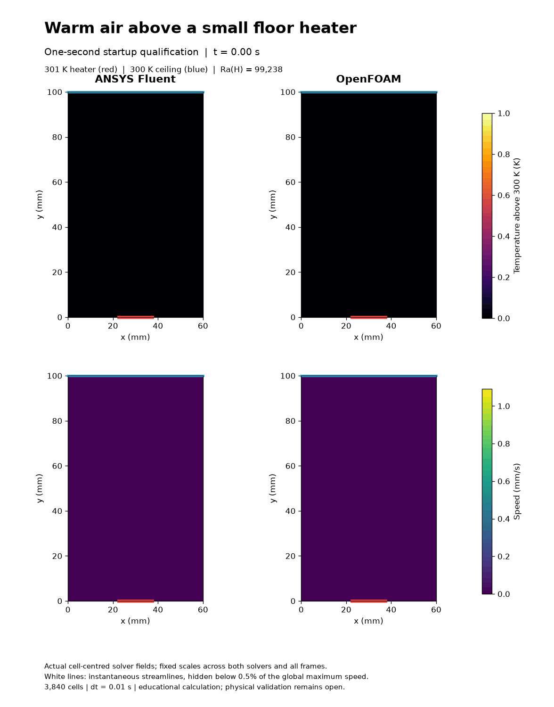
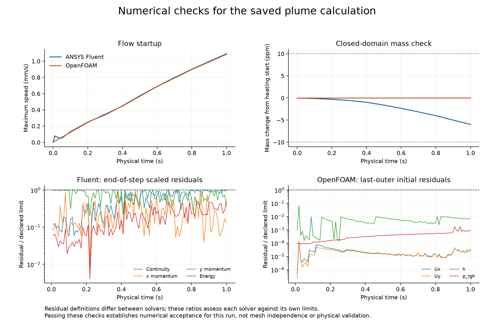

# Heater startup: paired native-field animation

This animation contains six actual saved states from 0 to 1 second, spaced by 0.2 seconds and displayed for 200 ms each. The endpoint is included before the loop restarts. Temperature and speed scales are fixed across both solvers and all frames. White lines are instantaneous streamlines, not particle paths; lines are masked below 0.5% of the global maximum speed. No intermediate flow states are synthesized.

The temperature panels show heat spreading from the 301 K floor heater into air initially near 300 K. The velocity panels reveal the upward motion and circulation forming alongside the heater. This is early startup, not a developed plume. The [qualification record](../README.md) gives the geometry, physics, accepted numerical settings and preserved unsuccessful attempts.

All 100 time steps pass each solver's declared residual criteria. Saved native fields pass finite-value, temperature-bound, closed-domain mass-drift and ideal-gas checks. Fluent has more saved startup samples than OpenFOAM; history lines connect available samples and do not imply identical temporal sampling. The final temperature difference is 0.000594 K and relative velocity-field L2 difference is 0.937%. Residual definitions differ between solvers, so the bottom panels do not rank their accuracy.

The renderer independently reads saved physical time and cell geometry before pairing fields. Fluent pressure offsets come from each native data file. OpenFOAM's initial density is reconstructed from p/(R*T), so its t=0 EOS check is not independent; later states use saved density. Source SHA-256 values are in native-field-audit.json. The original solver results are unchanged. No time-step independence, mesh independence or physical validation is established by this animation.

To reproduce on this workstation, dot-source E:/CFD-Learning-Lab/local/Use-Project.ps1. Set PYTHONPATH to repo/cfd-learning-lab/scripts, local/hot-patch-plume-v001 and local/hot-patch-plume-production-v001 beneath the project root. Use the project's Python environment to run executed-renderer.py --qualification --out followed by a fresh directory under E:/CFD-Learning-Lab/exports/figures. The renderer refuses to overwrite an existing output directory. The qualification's code directory contains the native-field helper; the production common file copied here supplies shared constants. The --qualification option explicitly selects the 100-step references and their original criteria, not the longer production settings.

The 20-second extension is a separate run in progress; no completion or new GitHub upload is claimed here.
