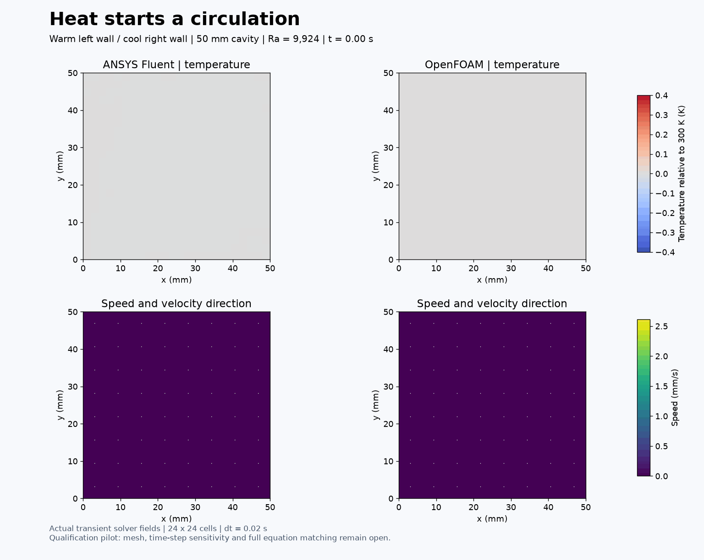
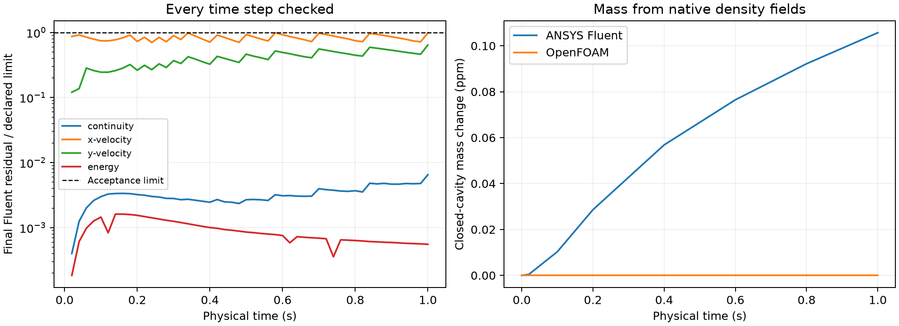

# Heated cavity: paired startup qualification

**Follow-up:** [Model 30](../../lessons/30-natural-convection/README.md) resolves the gravitational-work difference for new runs and adds paired 20-second calculations. This page preserves the earlier pilot and its original limitations.

A warm left wall and cool right wall start a circulation in an initially quiet square cavity. These are actual one-second transient calculations from ANSYS Fluent and OpenFOAM. This is a small qualification pilot, not a completed benchmark or an additional finished curriculum model.

## Conditions and status

- 50 mm square, shared 24 x 24 quadrilateral mesh; Fluent is 2D, OpenFOAM uses one 5 mm extruded layer with empty front/back patches.
- Initial temperature 300 K; left 300.4 K, right 299.6 K; top and bottom adiabatic during heating. All walls stationary and no slip. Gravity is 9.81 m/s² downward.
- Laminar ideal gas, nominal Ra = 9,924, Pr = 0.71; constant viscosity, conductivity and heat capacity. This is not a strict Boussinesq calculation.
- Both solvers computed 50 physical time steps of 0.02 s. Fluent allowed up to 100 inner iterations; OpenFOAM used four outer and two pressure correctors. Both ran on two processes, sequentially.
- The isothermal controls pass quiet-flow, temperature, closed-mass and equation-of-state checks. Fluent minimum orthogonal quality is 1.0; OpenFOAM reports Mesh OK.
- All 50 accepted Fluent time steps meet scaled residual limits of 1e-6 for continuity/momentum and 1e-9 for energy. OpenFOAM's final outer initial residuals and linear-solver residuals are retained separately; their normalization is not assumed identical to Fluent's.
- Eight Fluent and 51 OpenFOAM saved states pass temperature bounds, mass drift below 1e-5 and EOS error below 1e-6. Maximum heating-stage mass drift is 1.057e-7 in Fluent and 2.23e-16 in OpenFOAM. Final OpenFOAM wall mass flux is negligible.
- At 1 s, the maximum temperature difference between solvers is 0.000242 K and the velocity L2 difference relative to Fluent is about 0.897%. These are descriptive results, not proof of equation equivalence or validation.

## What remains open

Full energy-equation correspondence remains unresolved: the installed OpenFOAM fluid module includes an explicit rho U dot g source. The exact Fluent counterpart has not been established. Pressure work and kinetic energy are enabled; viscous work is disabled. The [Fluent heat-transfer theory](https://ansyshelp.ansys.com/public/views/secured/corp/v252/en/flu_th/flu_th_sec_hxfer_theory.html) documents these switches, but the source correspondence must still be checked. Do not use agreement here to assert identical equations.

No mesh, time-step, longer-time, heat-transfer benchmark or experimental validation is established. This is early startup, not steady convection. No aircraft claims follow from this pilot. Longer/finer production is pending those setup checks.

The six animation frames are saved states at 0, 0.2, 0.4, 0.6, 0.8 and 1 s, each displayed for 500 ms. No intermediate fields were invented. Streamlines belong to each instantaneous velocity field; they are not particle trajectories. Temperature and velocity use fixed common scales. Native cell vertices were mapped bijectively to the shared grid.

## Reproduction and preserved corrections

Native files are under E:/CFD-Learning-Lab/native/runs/natural-convection-qualification-fluent-v004 and natural-convection-qualification-openfoam-v002/{control,heated}. The original Fluent isothermal control remains under fluent-v001. The shared mesh is under native/meshes/natural-convection-qualification-v001. The accepted exported figures are under exports/figures/2026-11-07-natural-convection-paired-pilot-v003. Large native data, installed dependencies and licence material are excluded from this record.

The executed code is included in code/. It imports existing repository scripts; put repository/scripts and this code directory on PYTHONPATH after loading local/Use-Project.ps1. Paths are preserved execution paths, and drivers refuse existing output directories. To rerun, select a fresh version directory and update dependencies consistently; do not overwrite these runs. The plotting script reads the named saved runs and writes a new export directory. The audit script checks all saved states and source hashes.

Historical scripts are provenance, not an instruction to repeat known failures:

1. Fluent v001 saved a valid quiet control but its EOS audit used a different universal gas constant. The installed Fluent value 8314.47247122 was confirmed by native p/rho/T; the original failed audit is retained. OpenFOAM's linked value is 8314.4675910000005. Its molecular weight was adjusted to match the same specific gas constant, 287.0028467801174 J/(kg K).
2. OpenFOAM control v001 used heRhoThermo and missed the EOS check. Control v002 copied the same 0/, system/ and constant/ inputs (excluding polyMesh), changed only heRhoThermo to hePsiThermo in physicalProperties, and repeated conversion/solve. The installed psiThermo density is current p*psi. The actual resulting dictionaries are in openfoam-inputs/. All four control checks pass without loosening limits. Heating starts from the saved v002 control fields.
3. Fluent v002 completed heating with restored default residual limits and had a postprocessing API error. Its native image was recovered separately without changing its solution. Fluent v003 explicitly restored strict limits, but the first four steps hit the 30-iteration cap. Neither is the accepted strict pilot.
4. Fluent v004 repeats from the preserved isothermal control, explicitly reads back strict limits and allows 100 inner iterations. Every time step passes. This version and OpenFOAM v002 heated supply the figures here.

No source project was deleted or relocated. SHA-256 evidence is in saved-state-audit.json; native solver histories and earlier failed attempts remain local. The next bounded task is to resolve/document the energy formulation, then extend the visually useful circulation with mesh/time-step checks.

## Contributions

ANSYS Fluent and OpenFOAM computed the fields. No independent user execution, reflection, research novelty or physical validation is claimed.
